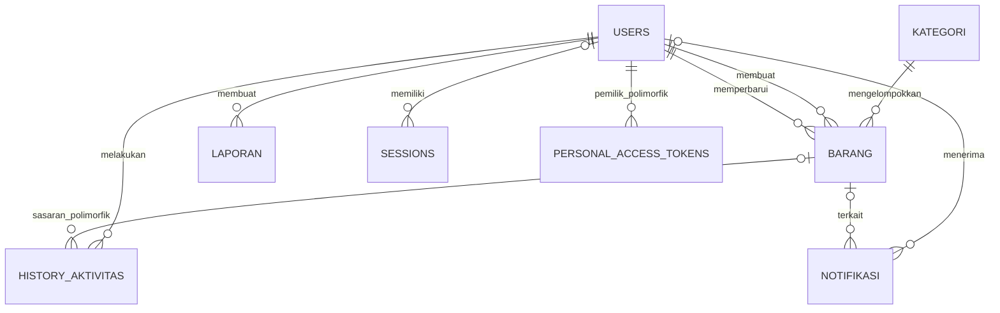

# Dokumentasi Database SIPERIN

Dokumen ini menjelaskan skema database yang didefinisikan di backend Laravel dan hasil pemeriksaan database aktif. Nama tabel/kolom mengikuti kode sumber, sehingga dapat dicocokkan dengan migration dan model.

## 1. Ringkasan database

- DBMS yang dikonfigurasi: MySQL.
- Host dan port: `127.0.0.1:3306`.
- Nama database: `siperin`.
- Database aktif diperiksa melalui koneksi Laravel pada 10 Oktober 2026.
- `php artisan migrate:status` menunjukkan seluruh 11 migration proyek sudah berstatus `Ran`.
- Pemeriksaan `SHOW TABLES` menemukan 15 tabel: 14 tabel yang didefinisikan dalam migration aplikasi/framework dan tabel `migrations` yang dikelola Laravel.
- Isi dan jumlah baris setiap tabel tidak diperiksa dalam dokumentasi ini. Status migration membuktikan perubahan skema telah dicatat sebagai diterapkan, bukan bahwa seeder tertentu telah dijalankan.

Konfigurasi koneksi berada di `backend/config/database.php`; nama database aktif ditentukan melalui `DB_DATABASE` dalam konfigurasi lingkungan backend. Kredensial koneksi tidak dicantumkan di sini.

## 2. Diagram relasi

Relasi pada diagram mencerminkan foreign key atau relasi aplikasi. Relasi sesi dan token bersifat opsional/polimorfik. `history_aktivitas.target_type` dan `target_id` adalah pasangan kolom biasa, bukan foreign key database.

## 3. Tabel domain aplikasi

### `users` — akun pengguna

Dibuat oleh `backend/database/migrations/0001_01_01_000000_create_users_table.php` dan digunakan oleh model `backend/app/Models/User.php`.

| Kolom                      | Tipe/aturan                                        | Keterangan                                    |
| -------------------------- | -------------------------------------------------- | --------------------------------------------- |
| `id`                       | ID auto-increment                                  | Kunci utama.                                  |
| `name`                     | String wajib                                       | Nama pengguna.                                |
| `username`                 | String unik                                        | Nama login.                                   |
| `email`                    | String unik                                        | Email pengguna.                               |
| `role`                     | Enum `admin`, `user`; default `user`             | Peran akun.                                   |
| `phone`                    | String nullable                                    | Nomor telepon.                                |
| `foto`                     | String nullable                                    | Path/lokasi foto profil.                      |
| `is_active`                | Boolean; default `true`                            | Status akun.                                  |
| `email_verified_at`        | Timestamp nullable                                 | Waktu verifikasi email.                       |
| `password`                 | String                                             | Kata sandi tersimpan sebagai hash oleh model. |
| `remember_token`           | Token nullable                                     | Token fitur “remember me”.                    |
| `created_at`, `updated_at` | Timestamp                                          | Waktu pembuatan dan perubahan.                |

Relasi model menyediakan barang yang dibuat, riwayat aktivitas, dan notifikasi. Tabel laporan juga memiliki `user_id` yang mengacu pada pengguna.

### `kategori` — kategori barang

Dibuat oleh `backend/database/migrations/2026_05_22_080545_create_kategoris_table.php` dan digunakan oleh `backend/app/Models/Kategori.php`.

| Kolom                      | Tipe/aturan       | Keterangan                     |
| -------------------------- | ----------------- | ------------------------------ |
| `id`                       | ID auto-increment | Kunci utama.                   |
| `nama_kategori`            | String unik       | Nama kategori.                 |
| `deskripsi`                | Text nullable     | Keterangan kategori.           |
| `created_at`, `updated_at` | Timestamp         | Waktu pembuatan dan perubahan. |

Satu kategori dapat memiliki banyak barang. Seeder menyediakan contoh kategori Elektronik, Furniture, Kendaraan, Alat Tulis, dan Lainnya.

### `barang` — inventaris

Dibuat oleh `backend/database/migrations/2026_05_22_080546_create_barangs_table.php`; kolom penilaian ditambahkan oleh `backend/database/migrations/2026_06_15_000000_add_scores_to_barangs_table.php`. Modelnya adalah `backend/app/Models/Barang.php`.

| Kolom                      | Tipe/aturan                               | Keterangan                                                                                   |
| -------------------------- | ----------------------------------------- | -------------------------------------------------------------------------------------------- |
| `id`                       | ID auto-increment                         | Kunci utama.                                                                                 |
| `kategori_id`              | Foreign ID wajib ke `kategori.id`         | Kategori barang. Penghapusan permanen kategori menghapus barang terkait (`cascadeOnDelete`). |
| `nama_barang`              | String wajib                              | Nama barang.                                                                                 |
| `merek`                    | String nullable                           | Merek.                                                                                       |
| `nomor_seri`               | String nullable                           | Nomor seri.                                                                                  |
| `ukuran`                   | String nullable                           | Ukuran/spesifikasi ukuran.                                                                   |
| `bahan`                    | String nullable                           | Bahan barang.                                                                                |
| `tahun_pembelian`          | YEAR                                      | Tahun pembelian.                                                                             |
| `kode_barang`              | String unik                               | Kode inventaris.                                                                             |
| `jumlah_barang`            | Unsigned integer; default `1`             | Jumlah unit.                                                                                 |
| `harga_beli`               | Decimal(15,2); default `0`                | Harga pembelian.                                                                             |
| `kondisi_barang`           | Enum `Sangat Baik`, `Baik`, `Rusak`       | Kondisi barang.                                                                              |
| `kelengkapan_score`        | Unsigned tiny integer nullable            | Skor aspek kelengkapan.                                                                      |
| `fungsional_score`         | Unsigned tiny integer nullable            | Skor aspek fungsional.                                                                       |
| `fisik_score`              | Unsigned tiny integer nullable            | Skor aspek fisik.                                                                            |
| `usia_score`               | Unsigned tiny integer nullable            | Skor aspek usia.                                                                             |
| `perawatan_score`          | Unsigned tiny integer nullable            | Skor aspek perawatan.                                                                        |
| `keamanan_score`           | Unsigned tiny integer nullable            | Skor aspek keamanan.                                                                         |
| `total_score`              | Unsigned small integer nullable           | Total keenam skor.                                                                           |
| `lokasi_ruangan`           | String wajib                              | Lokasi/ruangan barang.                                                                       |
| `keterangan`               | Text nullable                             | Catatan tambahan.                                                                            |
| `foto_barang`              | String nullable                           | Path/lokasi foto barang.                                                                     |
| `qr_code_path`             | String nullable                           | Path/lokasi QR code.                                                                         |
| `status`                   | Enum `Aktif`, `Nonaktif`; default `Aktif` | Status inventaris.                                                                           |
| `status_perawatan`         | String nullable                           | Status kebutuhan perawatan, misalnya `Perlu Perawatan`.                                      |
| `created_by`               | Foreign ID nullable ke `users.id`         | Pengguna pembuat. Jika pengguna dihapus permanen, nilainya menjadi NULL.                     |
| `updated_by`               | Foreign ID nullable ke `users.id`         | Pengguna terakhir yang memperbarui. Jika pengguna dihapus permanen, nilainya menjadi NULL.   |
| `created_at`, `updated_at` | Timestamp                                 | Waktu pembuatan dan perubahan.                                                               |
| `deleted_at`               | Timestamp nullable                        | Penanda soft delete; penghapusan biasa tidak langsung menghapus baris.                       |

Enam skor divalidasi oleh request API sebagai bilangan 1–3, sedangkan `total_score` divalidasi sebagai 6–18. Batas tersebut merupakan validasi aplikasi; definisi kolom migration sendiri tidak menambahkan constraint rentang skor.

`InventoryRuleBasedService` menjumlahkan keenam skor dan memetakan total 15–18 ke `Sangat Baik`, 10–14 ke `Baik`, dan kurang dari 10 ke `Rusak`. Ini berbeda dari `BarangClassificationService`, yang menetapkan `status_perawatan` menjadi `Perlu Perawatan` bila umur barang lebih dari lima tahun dan kondisi barang `Baik` atau `Rusak`.

### `history_aktivitas` — audit aktivitas

Dibuat oleh `backend/database/migrations/2026_05_22_080546_create_history_aktivitas_table.php`; kolom role ditambahkan oleh `backend/database/migrations/2026_05_28_200000_add_role_to_history_aktivitas_table.php`. Modelnya `backend/app/Models/HistoryAktivitas.php`.

| Kolom                      | Tipe/aturan                    | Keterangan                                                                             |
| -------------------------- | ------------------------------ | -------------------------------------------------------------------------------------- |
| `id`                       | ID auto-increment              | Kunci utama.                                                                           |
| `user_id`                  | Foreign ID wajib ke `users.id` | Pengguna yang melakukan aktivitas; penghapusan permanen pengguna menghapus riwayatnya. |
| `aktivitas`                | String                         | Jenis tindakan, misalnya tambah, edit, atau login.                                     |
| `target_type`              | String nullable                | Tipe objek sasaran. Bukan foreign key.                                                 |
| `target_id`                | Unsigned big integer nullable  | ID objek sasaran. Bukan foreign key.                                                   |
| `deskripsi`                | Text wajib                     | Penjelasan tindakan.                                                                   |
| `role`                     | String(20) nullable            | Role pengguna saat dicatat.                                                            |
| `ip_address`               | String(45) nullable            | Alamat IPv4/IPv6.                                                                      |
| `created_at`, `updated_at` | Timestamp                      | Waktu pencatatan.                                                                      |

### `laporan` — metadata ekspor laporan

Dibuat oleh `backend/database/migrations/2026_05_22_080547_create_laporans_table.php` dan digunakan oleh `backend/app/Models/Laporan.php`.

| Kolom                            | Tipe/aturan                    | Keterangan                                                                |
| -------------------------------- | ------------------------------ | ------------------------------------------------------------------------- |
| `id`                             | ID auto-increment              | Kunci utama.                                                              |
| `user_id`                        | Foreign ID wajib ke `users.id` | Pembuat laporan; laporan terkait terhapus bila pengguna dihapus permanen. |
| `judul`                          | String                         | Judul laporan.                                                            |
| `periode_mulai`, `periode_akhir` | Date nullable                  | Rentang tanggal laporan.                                                  |
| `filter_json`                    | JSON nullable                  | Filter yang digunakan, di-cast menjadi array oleh model.                  |
| `file_path`                      | String nullable                | Lokasi file ekspor.                                                       |
| `tipe`                           | Enum `pdf`, `excel` nullable   | Format laporan.                                                           |
| `created_at`, `updated_at`       | Timestamp                      | Waktu pembuatan dan perubahan.                                            |

Tabel ini menyimpan informasi laporan dan lokasi file; migration tidak menyimpan isi file laporan sebagai kolom database.

### `notifikasi` — pemberitahuan

Dibuat oleh `backend/database/migrations/2026_05_22_080548_create_notifikasis_table.php` dan digunakan oleh `backend/app/Models/Notifikasi.php`.

| Kolom                      | Tipe/aturan                                               | Keterangan                                                                |
| -------------------------- | --------------------------------------------------------- | ------------------------------------------------------------------------- |
| `id`                       | ID auto-increment                                         | Kunci utama.                                                              |
| `user_id`                  | Foreign ID nullable ke `users.id`                         | Penerima; penghapusan permanen pengguna menghapus notifikasi terkait.     |
| `barang_id`                | Foreign ID nullable ke `barang.id`                        | Barang terkait; penghapusan permanen barang menghapus notifikasi terkait. |
| `tipe`                     | Enum `barang_rusak`, `stok_menipis`, `info`, `verifikasi` | Kategori notifikasi.                                                      |
| `judul`                    | String                                                    | Judul notifikasi.                                                         |
| `pesan`                    | Text                                                      | Isi notifikasi.                                                           |
| `is_read`                  | Boolean; default `false`                                  | Apakah sudah dibaca.                                                      |
| `created_at`, `updated_at` | Timestamp                                                 | Waktu pembuatan dan perubahan.                                            |

### `password_reset_tokens` — reset kata sandi

Dibuat dalam migration pengguna.

| Kolom        | Tipe/aturan         | Keterangan                         |
| ------------ | ------------------- | ---------------------------------- |
| `email`      | String, primary key | Identitas akun yang meminta reset. |
| `token`      | String              | Token reset.                       |
| `created_at` | Timestamp nullable  | Waktu permintaan dibuat.           |

### `sessions` — sesi login

Dibuat dalam migration pengguna.

| Kolom           | Tipe/aturan                          | Keterangan                                                                    |
| --------------- | ------------------------------------ | ----------------------------------------------------------------------------- |
| `id`            | String, primary key                  | ID sesi.                                                                      |
| `user_id`       | Foreign ID nullable, memiliki indeks | ID pengguna bila sesi terautentikasi; migration tidak menetapkan foreign key. |
| `ip_address`    | String(45) nullable                  | Alamat IPv4/IPv6.                                                             |
| `user_agent`    | Text nullable                        | Informasi browser/perangkat.                                                  |
| `payload`       | Long text                            | Data sesi.                                                                    |
| `last_activity` | Integer, memiliki indeks             | Waktu aktivitas terakhir.                                                     |

## 4. Tabel infrastruktur Laravel

### `cache` dan `cache_locks`

Dibuat oleh `backend/database/migrations/0001_01_01_000001_create_cache_table.php`.

- `cache`: `key` sebagai primary key, `value` berupa medium text, dan `expiration` berupa integer berindeks.
- `cache_locks`: `key` sebagai primary key, `owner` sebagai string, dan `expiration` berupa integer berindeks.

### `jobs`, `job_batches`, dan `failed_jobs`

Dibuat oleh `backend/database/migrations/0001_01_01_000002_create_jobs_table.php`.

- `jobs`: `id`, `queue` (berindeks), `payload`, `attempts`, `reserved_at` nullable, `available_at`, dan `created_at`. Kolom waktu antrean adalah integer Unix timestamp.
- `job_batches`: `id` sebagai primary key, `name`, `total_jobs`, `pending_jobs`, `failed_jobs`, `failed_job_ids`, `options` nullable, `cancelled_at` nullable, `created_at`, dan `finished_at` nullable.
- `failed_jobs`: `id`, `uuid` unik, `connection`, `queue`, `payload`, `exception`, serta `failed_at` yang default-nya waktu saat ini.

### `personal_access_tokens` — token API Sanctum

Dibuat oleh `backend/database/migrations/2026_05_28_181130_create_personal_access_tokens_table.php`.

- `id`: kunci utama.
- `tokenable_type`, `tokenable_id`: identitas pemilik token secara polymorphic.
- `name`: nama token.
- `token`: string 64 karakter dan unik.
- `abilities`: daftar izin nullable.
- `last_used_at`: waktu terakhir digunakan, nullable.
- `expires_at`: waktu kedaluwarsa, nullable dan berindeks.
- `created_at`, `updated_at`: waktu pembuatan dan perubahan.

### `migrations` — catatan migration

Dibuat/dikelola oleh Laravel, bukan oleh migration aplikasi yang tercantum. Secara umum berisi ID, nama migration, dan nomor batch. Status yang diperiksa menunjukkan batch 1 berisi migration awal dan tabel domain, batch 2 menambahkan role riwayat, dan batch 3 menambahkan skor barang.

## 5. Peta hubungan dan penghapusan

- `kategori` 1 ke banyak `barang`. Foreign key `barang.kategori_id` memakai cascade saat kategori dihapus permanen.
- `users` 1 ke banyak `barang` melalui `created_by` dan `updated_by`. Foreign key barang memakai `nullOnDelete`, sehingga referensi pengguna dihapus tetapi barang tetap ada.
- `users` 1 ke banyak `history_aktivitas` dan `laporan`. Keduanya memakai cascade saat pengguna dihapus permanen.
- `users` dan `barang` masing-masing dapat terkait ke banyak `notifikasi`; foreign key notifikasi memakai cascade saat induk dihapus permanen.
- `history_aktivitas` menghubungkan target dengan pasangan `target_type`/`target_id` secara polymorphic sederhana. Database tidak menjamin bahwa target tersebut benar-benar ada.
- Barang memakai soft delete. Cascade foreign key baru berlaku saat baris barang/kategori benar-benar dihapus, bukan saat barang hanya diberi `deleted_at`.
- Tabel `sessions` memiliki `user_id` berindeks tanpa foreign key. Token Sanctum menggunakan pemilik polymorphic, sehingga token tidak hanya terikat ke tabel tertentu.

## 6. Seeder dan data contoh

`backend/database/seeders/DatabaseSeeder.php` mendefinisikan:

- 2 akun: admin dan user.
- 5 kategori.
- 5 contoh barang.
- 3 catatan aktivitas.
- Tidak mendefinisikan data contoh untuk laporan atau notifikasi.

Seeder menggunakan data tetap (`create`), termasuk username, email, dan nama kategori unik. Menjalankannya berulang pada database yang sudah berisi data tersebut berpotensi gagal karena duplikasi. Seeder mengatur kata sandi contoh `password123` dalam bentuk hash; ganti kata sandi tersebut sebelum akun dipakai di lingkungan nyata. Dokumentasi ini tidak menyatakan bahwa seeder telah dijalankan pada database aktif.

## 7. Catatan yang perlu diperiksa

1. **Perbedaan kapitalisasi `target_type`:** `backend/app/Services/ActivityLogService.php` menyimpan `class_basename($target)`, yang untuk model barang menghasilkan `Barang`. Relasi riwayat di `backend/app/Models/Barang.php` memfilter nilai lowercase `barang`. Catatan aktivitas yang dibuat melalui service dapat tidak muncul ketika relasi `Barang::history()` dipanggil. Seeder contoh memakai nilai lowercase.
2. **Skor tidak wajib tersimpan:** kolom skor nullable. API dapat menerima skor aspek secara opsional, sementara total dapat dihitung oleh layanan penilaian. Karena itu baris barang lama atau barang tanpa penilaian dapat memiliki skor NULL.
3. **`kategori_id` di API:** migration database menetapkannya wajib. Request API mengizinkan beberapa bentuk input kategori, tetapi validasi akhirnya tetap mengharuskan kategori yang dapat ditemukan.
4. **`status_perawatan` bukan enum database:** kolomnya string nullable. Nilai seperti `Perlu Perawatan` ditetapkan oleh aturan aplikasi, bukan dibatasi oleh enum di database.
5. **Ringkasan `db:show`:** pada pemeriksaan ini perintah tersebut gagal saat mencoba membaca `performance_schema.session_status` yang tidak tersedia di server lokal. Status migration dan daftar tabel tetap berhasil diperiksa terpisah.

## 8. File sumber utama

- Migration: `backend/database/migrations/`
- Seeder: `backend/database/seeders/DatabaseSeeder.php`
- Model: `backend/app/Models/`
- Koneksi database: `backend/config/database.php`
- Aturan skor: `backend/app/Services/InventoryRuleBasedService.php`
- Aturan perawatan: `backend/app/Services/BarangClassificationService.php`
