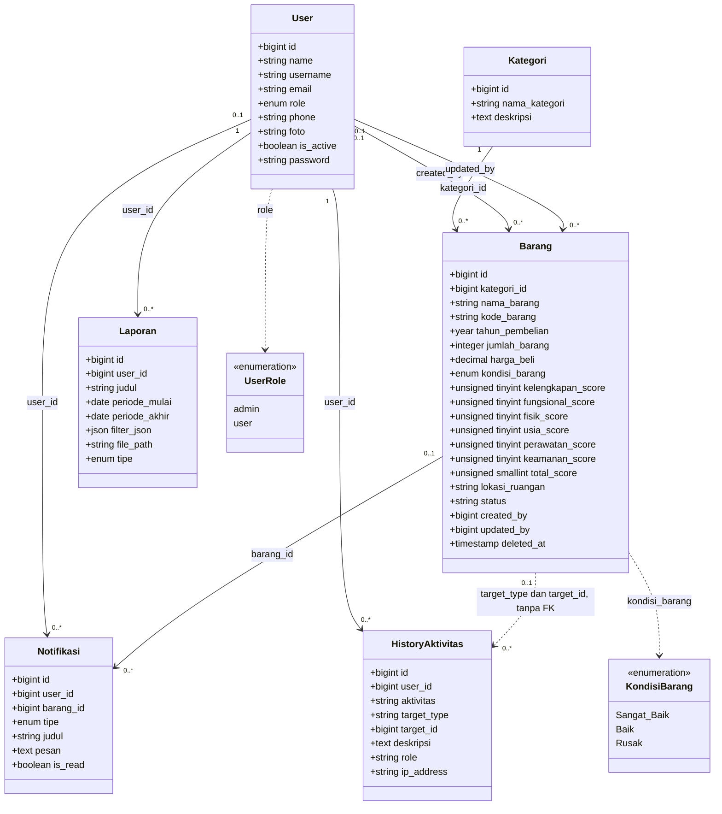

# Dokumentasi Database SIPERIN

Dokumen ini merangkum skema database backend SIPERIN berdasarkan migration,
model Eloquent, dan konfigurasi yang tersedia di project. Dokumen ini dapat
digunakan sebagai acuan penyusunan class diagram atau ERD.

## 1. Informasi database

- **Konfigurasi pada template lingkungan:** MySQL dengan nama database
  `siperin`, sebagaimana dicontohkan di `backend/.env.example`.
- **Konfigurasi runtime:** nilai pada `backend/.env` dapat mengganti template;
  konfigurasi Laravel juga memakai SQLite sebagai koneksi default jika
  `DB_CONNECTION` tidak ditetapkan.
- DBMS yang aktif pada deployment mengikuti konfigurasi `.env` di lingkungan
  tersebut.
- Skema dibentuk dan diperbarui oleh migration di
  `backend/database/migrations/`. Daftar migration di project menunjukkan
  struktur yang dimaksud, tetapi tidak membuktikan bahwa semua migration sudah
  dijalankan pada database yang sedang dipakai.
- Tipe fisik tertentu dapat berbeda menurut DBMS. Contohnya `id()` /
  `foreignId()` pada Laravel umumnya menjadi unsigned BIGINT pada MySQL,
  sedangkan representasi binary dan timestamp mengikuti driver database.

**Catatan:** jangan mencantumkan kredensial database dalam laporan. Informasi
host, username, dan password bukan bagian dari desain skema.

## 2. Ringkasan entitas aplikasi

| Tabel | Kegunaan |
|---|---|
| `users` | Akun, autentikasi, dan peran pengguna aplikasi. |
| `kategori` | Master kategori inventaris. |
| `barang` | Data utama barang inventaris, penilaian kondisi, dan informasi foto. |
| `history_aktivitas` | Audit aktivitas pengguna dan referensi target aktivitas. |
| `laporan` | Metadata laporan yang dapat dikaitkan dengan pembuatnya. |
| `notifikasi` | Pesan/notifikasi yang dapat ditujukan kepada pengguna dan/atau barang. |

## 3. Detail tabel aplikasi

Keterangan tipe: `string` Laravel tanpa panjang eksplisit biasanya berarti
VARCHAR(255); `id` berarti primary key auto-increment; `timestamps` berarti
`created_at` dan `updated_at`; `softDeletes` berarti `deleted_at` nullable.

### 3.1 `users`

Menyimpan akun aplikasi. `username` dan `email` masing-masing unik. Password
disimpan sebagai hash oleh model, bukan sebagai teks biasa.

| Kolom | Tipe | Null/default | Keterangan |
|---|---|---|---|
| `id` | BIGINT unsigned, PK, auto-increment | Tidak null | ID pengguna. |
| `name` | VARCHAR(255) | Tidak null | Nama pengguna. |
| `username` | VARCHAR(255), UNIQUE | Tidak null | Nama login unik. |
| `email` | VARCHAR(255), UNIQUE | Tidak null | Email unik. |
| `role` | ENUM(`admin`, `user`) | Tidak null, default `user` | Peran pengguna. |
| `phone` | VARCHAR(255) | Nullable | Nomor telepon. |
| `foto` | VARCHAR(255) | Nullable | Kolom legacy yang dipertahankan dan tidak digunakan oleh aplikasi. |
| `is_active` | BOOLEAN | Tidak null, default `true` | Status aktif akun. |
| `email_verified_at` | TIMESTAMP | Nullable | Waktu verifikasi email. |
| `password` | VARCHAR(255) | Tidak null | Hash password. |
| `remember_token` | VARCHAR(100) | Nullable | Token remember-me Laravel. |
| `created_at` | TIMESTAMP | Nullable | Waktu pembuatan record. |
| `updated_at` | TIMESTAMP | Nullable | Waktu perubahan record. |

Nilai enum role juga direpresentasikan oleh enum aplikasi `UserRole` dengan
nilai yang sama. Migration `2026_10_30_000000_merge_staff_and_pimpinan_roles_into_user`
mengubah nilai lama `staff` dan `pimpinan` menjadi `user`; setelah migration,
enum database hanya menerima `admin` dan `user`, dengan default `user`.
Perbedaan antara dua role lama tersebut tidak dapat dipulihkan saat rollback.

### 3.2 `kategori`

Menyimpan kategori barang. Nama kategori tidak boleh duplikat.

| Kolom | Tipe | Null/default | Keterangan |
|---|---|---|---|
| `id` | BIGINT unsigned, PK, auto-increment | Tidak null | ID kategori. |
| `nama_kategori` | VARCHAR(255), UNIQUE | Tidak null | Nama kategori unik. |
| `deskripsi` | TEXT | Nullable | Deskripsi kategori. |
| `created_at` | TIMESTAMP | Nullable | Waktu pembuatan record. |
| `updated_at` | TIMESTAMP | Nullable | Waktu perubahan record. |

### 3.3 `barang`

Menyimpan data inventaris. Tabel menggunakan soft delete, sehingga penghapusan
normal menandai `deleted_at` dan tidak langsung menghapus record dari database.

| Kolom | Tipe | Null/default | Keterangan |
|---|---|---|---|
| `id` | BIGINT unsigned, PK, auto-increment | Tidak null | ID barang. |
| `kategori_id` | BIGINT unsigned, FK → `kategori.id` | Tidak null | Kategori barang; kategori yang dihapus secara permanen menghapus barang terkait melalui cascade. |
| `nama_barang` | VARCHAR(255) | Tidak null | Nama barang. |
| `merek` | VARCHAR(255) | Nullable | Merek barang. |
| `nomor_seri` | VARCHAR(255) | Nullable | Nomor seri. |
| `ukuran` | VARCHAR(255) | Nullable | Ukuran/spesifikasi ukuran. |
| `bahan` | VARCHAR(255) | Nullable | Bahan barang. |
| `tahun_pembelian` | YEAR | Tidak null | Tahun pembelian. |
| `kode_barang` | VARCHAR(255), UNIQUE | Tidak null | Kode inventaris unik. |
| `jumlah_barang` | INTEGER unsigned | Tidak null, default `1` | Jumlah unit. |
| `harga_beli` | DECIMAL(15,2) | Tidak null, default `0` | Harga beli per unit. |
| `kondisi_barang` | ENUM(`Sangat Baik`, `Baik`, `Rusak`) | Tidak null | Kondisi barang. |
| `kelengkapan_score` | TINYINT unsigned | Nullable | Skor aspek kelengkapan. |
| `fungsional_score` | TINYINT unsigned | Nullable | Skor aspek fungsional. |
| `fisik_score` | TINYINT unsigned | Nullable | Skor aspek fisik. |
| `usia_score` | TINYINT unsigned | Nullable | Skor aspek usia. |
| `perawatan_score` | TINYINT unsigned | Nullable | Skor aspek perawatan. |
| `keamanan_score` | TINYINT unsigned | Nullable | Skor aspek keamanan. |
| `total_score` | SMALLINT unsigned | Nullable | Total skor penilaian. |
| `lokasi_ruangan` | VARCHAR(255) | Tidak null | Lokasi/ruangan barang. |
| `keterangan` | TEXT | Nullable | Catatan barang. |
| `foto_barang` | VARCHAR(255) | Nullable | Path relatif foto pada disk `public` untuk unggahan baru; juga mempertahankan kompatibilitas data/path lama. |
| `foto_blob` | BLOB (MySQL: LONGBLOB) | Nullable | Foto binary dari data lama; tetap dibaca sebagai fallback agar migrasi terdahulu tidak memutus foto yang tersimpan. Unggahan baru tidak disimpan sebagai BLOB. Disembunyikan dari serialisasi model. |
| `foto_mime` | VARCHAR(100) | Nullable | MIME type foto BLOB lama, misalnya `image/jpeg`; unggahan baru ditentukan dari isi file pada saat dibaca. |
| `qr_code_path` | VARCHAR(255) | Nullable | Path/referensi file QR code. |
| `status` | ENUM(`Aktif`, `Nonaktif`) | Tidak null, default `Aktif` | Status inventaris. |
| `status_perawatan` | VARCHAR(255) | Nullable | Informasi status perawatan. |
| `created_by` | BIGINT unsigned, FK → `users.id` | Nullable | Pengguna pembuat; menjadi NULL jika user dihapus permanen. |
| `updated_by` | BIGINT unsigned, FK → `users.id` | Nullable | Pengguna terakhir yang memperbarui; menjadi NULL jika user dihapus permanen. |
| `created_at` | TIMESTAMP | Nullable | Waktu pembuatan record. |
| `updated_at` | TIMESTAMP | Nullable | Waktu perubahan record. |
| `deleted_at` | TIMESTAMP | Nullable | Penanda soft delete. |

Nilai `kondisi_barang` juga didefinisikan oleh enum aplikasi `KondisiBarang`.
Migration foto menambahkan `foto_blob` dan `foto_mime`; foto lama yang berhasil
divalidasi dipindahkan ke blob dan `foto_barang` dikosongkan. Foto yang tidak
berhasil dipindahkan dapat tetap memiliki path lama.

### 3.4 `history_aktivitas`

Menyimpan catatan tindakan pengguna. `target_type` dan `target_id` adalah
referensi target berbasis pasangan nilai, bukan foreign key database.

| Kolom | Tipe | Null/default | Keterangan |
|---|---|---|---|
| `id` | BIGINT unsigned, PK, auto-increment | Tidak null | ID aktivitas. |
| `user_id` | BIGINT unsigned, FK → `users.id` | Tidak null | Pemilik/pelaku aktivitas; aktivitas terhapus jika user dihapus permanen (cascade). |
| `aktivitas` | VARCHAR(255) | Tidak null | Jenis aktivitas, misalnya tambah/edit/login sesuai pemakaian aplikasi. |
| `target_type` | VARCHAR(255) | Nullable | Jenis objek target; untuk relasi riwayat barang, model menggunakan nilai `barang`. |
| `target_id` | BIGINT unsigned | Nullable | ID target. Tidak memiliki constraint FK ke `barang.id`. |
| `deskripsi` | TEXT | Tidak null | Rincian aktivitas. |
| `role` | VARCHAR(20) | Nullable | Role yang dicatat pada aktivitas. |
| `ip_address` | VARCHAR(45) | Nullable | Alamat IP, panjang mendukung IPv4/IPv6. |
| `created_at` | TIMESTAMP | Nullable | Waktu pembuatan aktivitas. |
| `updated_at` | TIMESTAMP | Nullable | Waktu perubahan record. |

Model `Barang` mengambil riwayat yang `target_type`-nya `barang` dan
`target_id`-nya sama dengan ID barang. Karena tidak ada foreign key, integritas
target tersebut dikelola oleh aplikasi.

### 3.5 `laporan`

Menyimpan metadata laporan dan filter opsional. `user_id` wajib dan memiliki
foreign key ke `users.id` dengan cascade on delete.

| Kolom | Tipe | Null/default | Keterangan |
|---|---|---|---|
| `id` | BIGINT unsigned, PK, auto-increment | Tidak null | ID metadata laporan. |
| `user_id` | BIGINT unsigned, FK → `users.id` | Tidak null | Pengguna terkait; record laporan terhapus jika user dihapus permanen. |
| `judul` | VARCHAR(255) | Tidak null | Judul laporan. |
| `periode_mulai` | DATE | Nullable | Awal periode laporan. |
| `periode_akhir` | DATE | Nullable | Akhir periode laporan. |
| `filter_json` | JSON | Nullable | Parameter/filter laporan; dicast menjadi array pada model. |
| `file_path` | VARCHAR(255) | Nullable | Lokasi file laporan jika disimpan. |
| `tipe` | ENUM(`pdf`, `excel`) | Nullable | Jenis file laporan. |
| `created_at` | TIMESTAMP | Nullable | Waktu pembuatan record. |
| `updated_at` | TIMESTAMP | Nullable | Waktu perubahan record. |

**Pembedaan penting:** tabel dan model `laporan` tersedia di skema, tetapi
endpoint laporan inventaris yang ada saat ini membentuk laporan dari data
`barang` dan `kategori`, lalu mengembalikan atau mengunduh hasilnya. Controller
tersebut tidak menyimpan hasilnya ke tabel `laporan`. Jadi jangan menganggap
setiap laporan yang diunduh otomatis menjadi record pada tabel ini.

### 3.6 `notifikasi`

Menyimpan pesan notifikasi. Kedua relasi foreign key bersifat nullable.

| Kolom | Tipe | Null/default | Keterangan |
|---|---|---|---|
| `id` | BIGINT unsigned, PK, auto-increment | Tidak null | ID notifikasi. |
| `user_id` | BIGINT unsigned, FK → `users.id` | Nullable | Pengguna penerima; notifikasi terkait ikut terhapus jika user dihapus permanen. |
| `barang_id` | BIGINT unsigned, FK → `barang.id` | Nullable | Barang terkait; notifikasi terkait ikut terhapus jika barang dihapus permanen. |
| `tipe` | ENUM(`barang_rusak`, `stok_menipis`, `info`, `verifikasi`) | Tidak null | Kategori notifikasi. |
| `judul` | VARCHAR(255) | Tidak null | Judul notifikasi. |
| `pesan` | TEXT | Tidak null | Isi notifikasi. |
| `is_read` | BOOLEAN | Tidak null, default `false` | Status sudah dibaca. |
| `created_at` | TIMESTAMP | Nullable | Waktu pembuatan record. |
| `updated_at` | TIMESTAMP | Nullable | Waktu perubahan record. |

## 4. Relasi antarentitas

| Relasi | Kardinalitas | Implementasi dan aturan |
|---|---|---|
| `kategori` — `barang` | Satu kategori memiliki 0..* barang; setiap barang wajib memiliki 1 kategori. | `barang.kategori_id` → `kategori.id`, cascade saat kategori dihapus permanen. |
| `users` — `barang` (pembuat) | Satu user dapat membuat 0..* barang; setiap barang memiliki 0..1 user pembuat. | `barang.created_by` → `users.id`, nullable, set NULL saat user dihapus permanen. |
| `users` — `barang` (pengubah) | Satu user dapat memperbarui 0..* barang; setiap barang memiliki 0..1 user pengubah. | `barang.updated_by` → `users.id`, nullable, set NULL saat user dihapus permanen. |
| `users` — `history_aktivitas` | Satu user memiliki 0..* aktivitas; setiap aktivitas wajib memiliki 1 user. | `history_aktivitas.user_id` → `users.id`, cascade saat user dihapus permanen. |
| `users` — `laporan` | Satu user dapat terkait dengan 0..* laporan; setiap record laporan wajib memiliki 1 user. | `laporan.user_id` → `users.id`, cascade saat user dihapus permanen. |
| `users` — `notifikasi` | Satu user dapat memiliki 0..* notifikasi; setiap notifikasi memiliki 0..1 user. | `notifikasi.user_id` → `users.id`, nullable, cascade saat user dihapus permanen. |
| `barang` — `notifikasi` | Satu barang dapat terkait dengan 0..* notifikasi; setiap notifikasi memiliki 0..1 barang. | `notifikasi.barang_id` → `barang.id`, nullable, cascade saat barang dihapus permanen. |
| `barang` — `history_aktivitas` | Satu barang dapat ditunjuk oleh 0..* aktivitas. | Referensi aplikasi melalui `target_type='barang'` dan `target_id`; **bukan FK database**. |

Cascade yang disebut di tabel ini berlaku pada penghapusan permanen database.
Soft delete pada `barang` hanya mengisi `deleted_at` dan tidak dengan sendirinya
menjalankan cascade foreign key.

## 5. Diagram class/entitas domain

Diagram berikut menampilkan entitas utama, kolom kunci, dan asosiasi domain
aplikasi. Tabel infrastruktur Laravel tidak ditampilkan supaya diagram laporan
tetap berfokus pada fitur inventaris.

Dalam diagram di atas, `Barang` memiliki dua asosiasi berbeda ke `User`:
pembuat (`created_by`) dan pengubah (`updated_by`). Garis putus-putus dari
`Barang` ke `HistoryAktivitas` menunjukkan referensi logis aplikasi saja,
bukan constraint foreign key.

## 6. Tabel pendukung Laravel

Tabel berikut mendukung autentikasi, session, cache, queue, token API, dan
pelacakan migration. Umumnya tabel ini tidak dimasukkan ke class diagram domain
inventaris, tetapi tetap bagian dari database aplikasi.

| Tabel | Kolom penting dan fungsi |
|---|---|
| `password_reset_tokens` | `email` (PK), `token`, `created_at`; token reset password. |
| `sessions` | `id` (PK), `user_id` nullable dan terindeks, `ip_address`, `user_agent`, `payload`, `last_activity`; penyimpanan session database. `user_id` tidak didefinisikan sebagai FK pada migration. |
| `personal_access_tokens` | `id` (PK), `tokenable_type` + `tokenable_id` (relasi polymorphic dan terindeks), `name`, `token` unik, `abilities` nullable, `last_used_at` nullable, `expires_at` nullable dan terindeks, timestamps; token API Laravel Sanctum. |
| `cache` | `key` (PK), `value`, `expiration` terindeks; penyimpanan cache database. |
| `cache_locks` | `key` (PK), `owner`, `expiration` terindeks; lock cache. |
| `jobs` | `id` (PK), `queue` terindeks, `payload`, `attempts`, `reserved_at` nullable, `available_at`, `created_at`; antrean pekerjaan. |
| `job_batches` | `id` (PK), `name`, `total_jobs`, `pending_jobs`, `failed_jobs`, `failed_job_ids`, `options` nullable, `cancelled_at` nullable, `created_at`, `finished_at` nullable; metadata batch queue. |
| `failed_jobs` | `id` (PK), `uuid` unik, `connection`, `queue`, `payload`, `exception`, `failed_at`; queue job yang gagal. |
| `migrations` | Tabel bookkeeping Laravel yang dibuat oleh migration runner; menyimpan nama migration dan batch yang telah dicatat berjalan. Bukan entitas bisnis inventaris. |

## 7. Catatan integritas dan interpretasi class diagram

1. Primary key setiap tabel bisnis adalah `id`, kecuali tabel pendukung Laravel
   yang memiliki key sesuai fungsi masing-masing.
2. Foreign key yang benar-benar dideklarasikan pada migration domain adalah:
   `barang.kategori_id`, `barang.created_by`, `barang.updated_by`,
   `history_aktivitas.user_id`, `laporan.user_id`, `notifikasi.user_id`, dan
   `notifikasi.barang_id`.
3. Jangan menggambar `history_aktivitas.target_id` sebagai foreign key.
   Kolom itu tidak memiliki constraint dan targetnya ditentukan oleh
   `target_type`.
4. Relasi `sessions.user_id` dan `personal_access_tokens.tokenable_*` adalah
   dukungan framework; jangan samakan keduanya dengan relasi domain inventaris.
5. `barang.deleted_at` berasal dari soft delete. Record barang yang ter-soft
   delete masih tersimpan dan umumnya tidak diambil oleh query Eloquent standar.
6. `foto_barang` menyimpan path pada filesystem untuk unggahan baru, sedangkan
   `foto_blob` tetap dipakai sebagai fallback pembacaan foto lama. Migration
   sebelumnya dapat memindahkan foto lama yang valid dari path ke BLOB; data
   yang tidak berhasil dipindahkan dapat tetap memakai path lama. Jangan
   menghapus file atau kolom lama tanpa memeriksa referensinya.
7. Kolom skor tidak memiliki batas nilai bisnis berupa constraint pada
   migration. Tipe unsigned memberi batas representasi tipe database, tetapi
   rentang skor yang sah harus dilihat dari aturan aplikasi bila dibutuhkan
   dalam uraian laporan.

## 8. Sumber pemeriksaan

- `backend/database/migrations/` — definisi tabel, kolom, index, foreign key,
  enum, dan perubahan skema.
- `backend/app/Models/` — nama tabel, fillable/casts, dan relasi Eloquent.
- `backend/app/Enums/` — enum role dan kondisi barang.
- `backend/config/database.php` dan `backend/.env.example` — konfigurasi
  koneksi default/template. Nilai runtime pada `backend/.env` dapat berbeda.
- `backend/app/Http/Controllers/Api/LaporanInventarisController.php` — cara
  laporan inventaris dibentuk dan diekspor saat ini.
